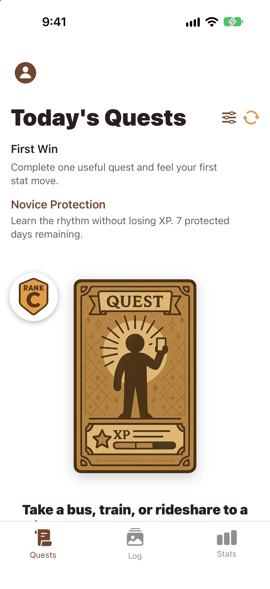
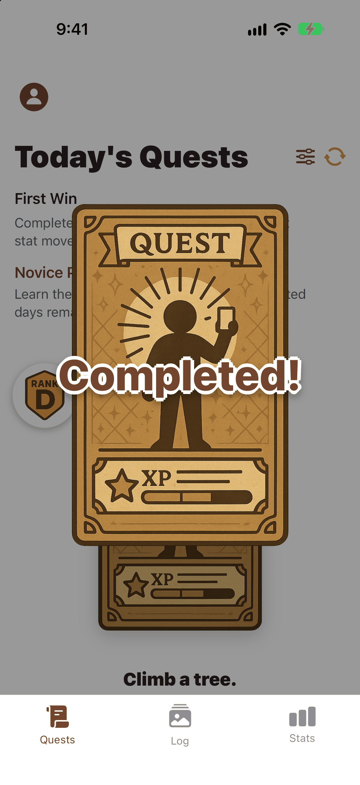
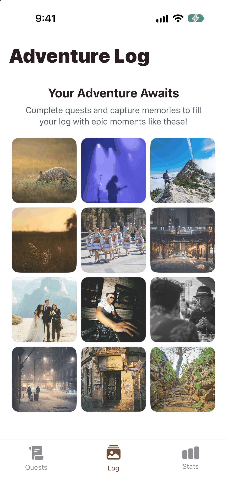
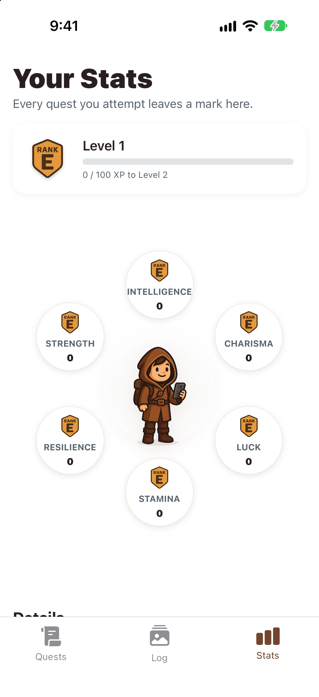

# Solo Quest XP

Solo Quest XP gives you three small real-world quests every day and turns them into RPG progress: XP, six stats, levels, and ranks from E to S. It is a SwiftUI app for iPhone and iPad.

<p align="center">
  
</p>

<p align="center"><a href=".github/media/demo.mp4">▶ Watch the full demo (MP4)</a></p>

<p align="center">
  
  
  
  
</p>

## Features

- **Daily quests**: three quests a day, picked from 1,570 bundled templates. A new set arrives at 4:00 AM local time. Rerolls swap a quest you can't do today.
- **XP, stats, and ranks**: every quest trains a primary stat and secondary stats (Strength, Stamina, Intelligence, Charisma, Resilience, Luck). Levels move you through ranks E, D, C, B, A, and S.
- **Streaks and penalties**: skipped days cost XP, with a 7-day novice protection window for new players.
- **Quest preferences**: filter quests by category, social intensity, energy, duration, cost, location, time of day, and comfort zone.
- **Adventure Log**: attach photos and videos to completed quests, save them to a photo album, and share them.
- **Adventurer profile quiz**: answer a short quiz in Settings to set your starting stats.
- **Localized** in English, German, Spanish, and French. Data stays on the device, with optional iCloud sync.

## Tech stack

SwiftUI · Core Data · CloudKit · [Factory](https://github.com/hmlongco/Factory) · [RevenueCat](https://github.com/RevenueCat/purchases-ios-spm) · [Clerk](https://github.com/clerk/clerk-ios) · [PostHog](https://github.com/PostHog/posthog-ios)

## Requirements

- Xcode 26 or later
- iOS 17.6+ (iPhone and iPad)

## Getting started

```bash
git clone https://github.com/dqships/solo-quest-ios.git
cd solo-quest-ios
cp Config/Secrets.xcconfig.example Config/Secrets.xcconfig
open "Solo Quest.xcodeproj"
```

1. Build and run the `Solo Quest` scheme on a simulator. It works with every value in `Config/Secrets.xcconfig` (git-ignored) left empty: you get daily quests, stats, and the Adventure Log, with data stored on the device.
2. Fill in only the services you want to use:
   - `REVENUE_CAT_API_KEY`: RevenueCat public SDK key for the Guild Pass subscription and reroll packs.
   - `CLERK_PUBLISHABLE_KEY`: Clerk key for sign-in. Without it, the app runs with no account and never asks you to sign in.
   - `POSTHOG_API_KEY`: PostHog project key for analytics.
   - `CLOUDKIT_CONTAINER_IDENTIFIER`: your iCloud container, to turn on iCloud sync.
3. To run on a device, select your own team under **Signing & Capabilities** and replace the placeholder bundle identifier (`com.example.soloquest`). In `Solo Quest/Solo Quest.entitlements`, replace the iCloud container (`iCloud.com.example.soloquest`) and the Clerk associated domain (`clerk.example.com`) with your own, or remove those capabilities.

Before shipping your own build, replace the placeholder support email (`support@example.com`), the "Your Company" copyright line, the template Privacy Policy and Terms in `Solo Quest/Resources/Legal/`, and the product IDs (`com.example.soloquest.*`) in `Solo Quest/ViewModels/Store/Catalog/StoreProductCatalog.swift`.

## Adding quests

Quest content lives in `Solo Quest/Resources/`:

- `quest_*.json`: quest templates. Each quest has an `id`, a `template` (use `[topic]` or `[person]` slots for variety), a `size` (`micro` to `massive`), a `primaryStat`, `secondaryStats`, and filter fields such as `socialIntensity`, `energyLevel`, `duration`, `costLevel`, and `locationType`.
- `game_config.json`: game balance, including quests per day, XP per quest size, level curve, ranks, and penalties.
- `topics*.json` and `characters*.json`: words that fill the `[topic]` and `[person]` slots, per language.

Add a new quest file to the list in `Solo Quest/Services/QuestEngine/QuestEngine+Loading.swift`.

## Project structure

```
Solo Quest/
  App/                 App entry point, startup, and service configuration
  Models/              Core Data classes and Swift model types
  Services/            Business logic (QuestEngine, UserStatsManager, persistence, purchases)
  ViewModels/          Screen state
  Views/               SwiftUI screens and components
  Resources/           Quest content, game balance, legal text, and color palette
  AppStoreScreenshots/ Debug-only fixture screens used for screenshots
Solo QuestTests/       Unit tests
Config/                Build settings, Info.plist, and the secrets template
```

## Tests

Run the unit tests from Xcode (`⌘U`) or the command line:

```bash
xcodebuild test -project "Solo Quest.xcodeproj" -scheme "Solo Quest" -destination "platform=iOS Simulator,name=iPhone 17"
```

## Screenshots

Debug builds can render fixture screens with sample data. Launch with `-SoloQuestAppStoreScreenshotMode -SoloQuestAppStoreScreenshotScreen <1-4>` to show today's quests, a completed quest, the Adventure Log, or a stat detail.

## License

[MIT](LICENSE) © 2026 DaQuan Louden
